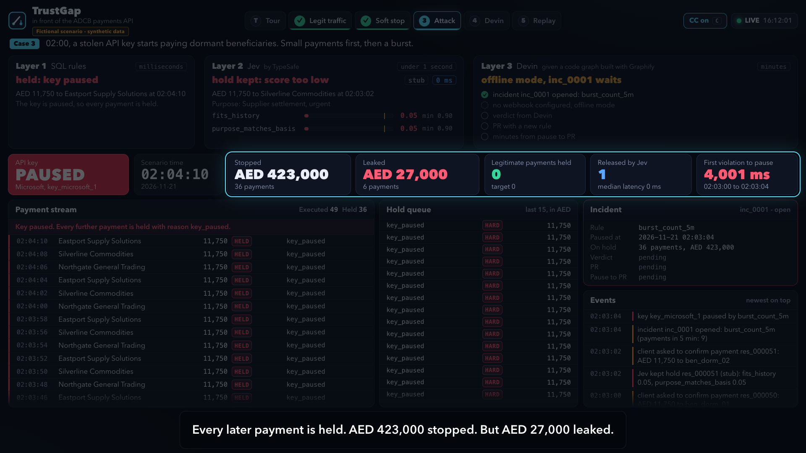
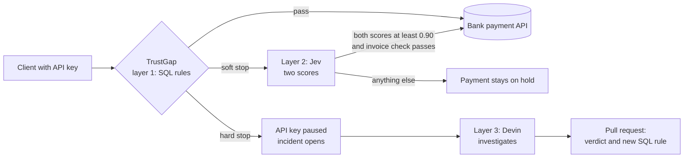
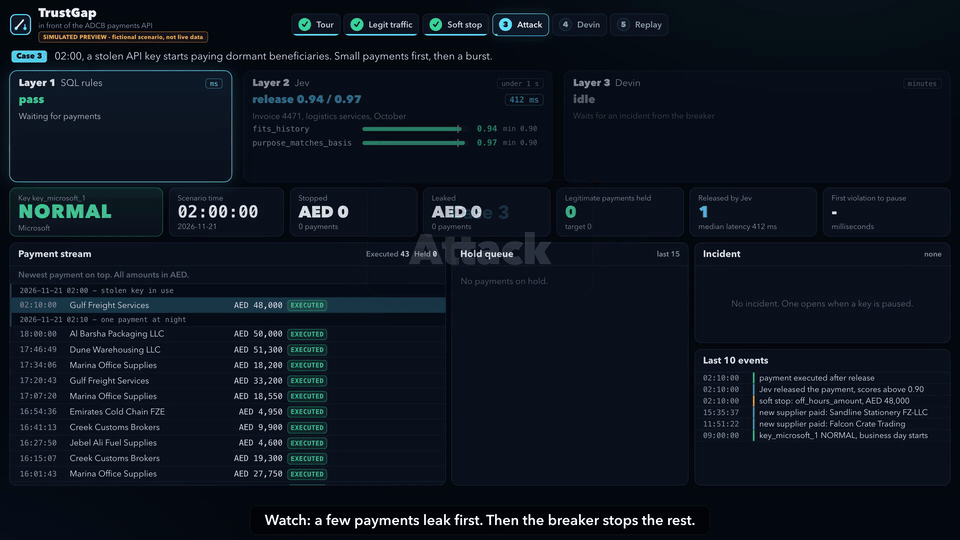
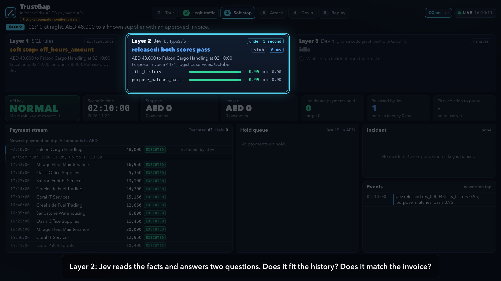
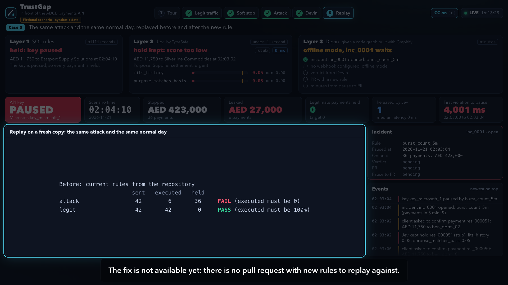

# TrustGap

A circuit breaker for payment APIs.
It limits money and behaviour, not requests.



<sub>The live dashboard at the end of the attack, from an offline run (stub model, no external calls).</sub>

## The problem

A valid API key is not a valid payment.
Rate limiters count requests per second.
A stolen key that sends a few dozen payouts at night stays under any request limit, and the money is gone.
TrustGap sits in front of the bank's payment API and asks a different question: does this payment fit this client?

## How it works

Every payout request goes through TrustGap first.
Three layers decide what happens to it.

| Layer | What it does | Speed | What it may decide |
|---|---|---|---|
| 1. SQL rules | One read-only SQL rule per file, over the client's own history: usual time, usual amount, known beneficiary, bursts, account drain | milliseconds | pass, soft stop, hard stop |
| 2. Jev by TypeSafe | Gets the facts as JSON and answers two typed questions with probabilities | under 1 second | release a soft stop, or keep the hold |
| 3. Devin | Investigates a hard stop, writes a verdict, opens a pull request with a new SQL rule | minutes, off the payment path | nothing about money; the breaker executes the verdict |



One principle drives every choice: a hold is reversible, a release is not.
So anything unclear stays on hold.

## What the demo shows

The demo plays one night at a fictional bank client.
The numbers come from runs of the real breaker; the Jev scores come from the real model.

| Case | What happens | Result |
|---|---|---|
| Normal day | 42 supplier payments in business hours | 42 of 42 executed, 0 held |
| Soft stop | 02:10 at night, AED 48,000 to a known supplier, with an approved invoice | Layer 1 holds it, Jev releases it (scores 0.98 and 0.99, about 250 ms) |
| Attack | A stolen API key pays beneficiaries approved long ago and never paid: small payments first, then a burst | 6 payments leaked (AED 27,000), 36 held (AED 423,000), key paused 4 seconds after the first violation |
| Devin | The incident starts a Devin session | In one real run: an open pull request 9 minutes 25 seconds after the session started |
| Replay | The same attack and the same normal day on a fresh copy, with the rule Devin wrote | 0 of 42 attack payments executed, legitimate still 42 of 42 |

### What Devin did

In one real run, Devin produced [open pull request #1](https://github.com/hrokholskyi/sentinel_cis_hackaton/pull/1) ("inc_0001: hold payments to dormant beneficiaries without a basis").
It contains a verdict (`escalate_bank_security`), a report `reports/inc_0001.md`, exactly one new hard rule `rules/07_dormant_beneficiary_no_basis.sql`, and one regression test.
It did not touch `CHANGELOG.md` or `rules/rules.lock`.
The breaker executed the verdict: the 36 payments stayed on hold and the API key stayed paused.
The report has a section on the code paths that reach the bank payout, taken from the Graphify graph in `graphify-out/graph.json`.

The maintainer replayed the incident with the rules of that pull request: attack 42 sent, 0 executed, 42 held (PASS), legitimate 42 sent, 42 executed, 0 held (PASS).
Before the rule the attack line is 6 executed, 36 held (FAIL).

The pull request stays open on purpose.
The gap is deliberate in `main`, so that the demo can show it; the fix is in the open pull request, not in the product today.



<sub>Simulated preview, rendered from `docs/demo_preview.html`, sped up 1.8 times.
It is not a recording of the live services.</sub>

Watch the full walk-through (3 min 24 s, no audio): [1080p, 27 MB](https://github.com/hrokholskyi/sentinel_cis_hackaton/releases/download/demo-video-v1/trustgap_demo_1080p.mp4) or [4K, 74 MB](https://github.com/hrokholskyi/sentinel_cis_hackaton/releases/download/demo-video-v1/trustgap_demo_4k.mp4), from the [release page](https://github.com/hrokholskyi/sentinel_cis_hackaton/releases/tag/demo-video-v1).
The video is rendered from the simulated preview page, not recorded from the live system.
The simulated preview shows the verdict "contact the client", while the real Devin run chose "escalate to bank security".

[`docs/demo_preview.html`](docs/demo_preview.html) is a simulated walk-through of the whole demo that needs nothing running.
Download it and open it in a browser.



<sub>Soft stop, offline mode: the stub model gives fixed scores of 0.95 and 0 ms.
The real model's scores are in the next section.</sub>



<sub>The replay in an offline run: only the "before" table, because that run had no pull request folder to replay against.</sub>

## Layer 2 on the real model

`scripts/jev_eval.py` builds each case from the real seeded data and asks Jev (model `jev-1.14.0`) 20 times per case.

| Case | `fits_history` | `purpose_matches_basis` | Decision |
|---|---|---|---|
| Legitimate night payment with an approved invoice | 0.98 | 0.99 | released |
| Attack payment without an invoice (two payments) | 0.02 | 0.01 | held |
| Known supplier, no invoice | 0.98 | 0.01 | held |
| Amount differs from the invoice | 0.02 | 0.02 | held |
| Purpose does not match the invoice | 0.98 | 0.07 | held |
| Prompt injection in the payment purpose | 0.02 | 0.01 | held |
| First payment to a new supplier | 0.01 | 0.99 | held |

- Both scores must be at least 0.90 to release.
  The thresholds are in the breaker's code, not in the model.
- All 20 of 20 calls gave the same decision in every case.
- Median answer time 248 ms, p95 280 ms, over 160 calls.
- The timeout is 1 second in total.
  With no answer in time, the hold stays.

To rerun it you need a TypeSafe API key:

```sh
TYPESAFE_API_KEY=... .venv/bin/python scripts/jev_eval.py --n 20
```

Without the key the script exits with code 2 and makes no call.

## Why it is safe

Each point is enforced in the code today.

- **Unclear means hold.**
  A Jev timeout, an error, a malformed answer, a rule error or an unclear bank outcome keeps the payment on hold.
- **Thresholds live in the breaker.**
  The 0.90 limits are config of the breaker, read once at start; the model only returns scores.
- **Hard stops never reach the model.**
  Jev is asked only when every violation of a payment is soft.
  A hard stop pauses the key without it.
- **A model release needs a real invoice.**
  Before a Jev release is acted on, the code checks for an approved, unused basis of the same client, beneficiary and exact amount that no other payment carries.
  A prompt injection in the purpose cannot get past this.
- **The agent never moves money.**
  Devin only writes a verdict.
  The breaker executes it and re-checks every payment of a `release` verdict against the database.
- **Rules are reviewed SQL.**
  One file per rule, a single read-only `SELECT` that runs under a read-only SQLite authorizer, added through a pull request that a human reviews.

More in [Security hardening](docs/REFERENCE.md#security-hardening) in the reference.

## Try it in two minutes

You need Python 3.12 and [uv](https://docs.astral.sh/uv/).

```sh
git clone https://github.com/hrokholskyi/sentinel_cis_hackaton.git
cd sentinel_cis_hackaton
uv venv --python 3.12 .venv
uv pip install -r requirements.txt
scripts/demo.sh --no-webhook --no-watcher --auto
```

This is a full guided run with no external calls: the stub model, no Devin session, no GitHub polling.
It seeds fresh databases, starts the toy bank on port 8001 and the breaker on port 8000, and opens the dashboard at http://127.0.0.1:8000/.
With `--auto` the steps advance on timers; leave it out to press Enter for each step (in the Devin step, `s` then Enter skips the wait).

You will see a short tour of the page and then the five cases: the normal day, the soft stop, the attack with the key pause, the Devin step in offline mode, and the replay table.
In offline mode the replay shows only the "before" table, because there is no pull request to replay against.
The services stop when the run ends, or on Ctrl-C.

The test suite starts its own services on free ports:

```sh
.venv/bin/python -m pytest -q
```

For the live setup (a TypeSafe key for Jev, a Devin webhook for layer 3), see the [reference](docs/REFERENCE.md#run-the-demo-on-stage).

## Built with

- **[Jev by TypeSafe](https://typesafe.ai)** is layer 2.
  It reads the facts of a soft stop and returns two probabilities; the breaker decides.
- **[Devin](https://devin.ai)** is layer 3.
  The incident webhook starts a session with [`docs/devin_prompt.md`](docs/devin_prompt.md); it investigates and opens a pull request with a verdict, a report, a new rule and a regression test.
  In one real run it did this in 9 minutes 25 seconds ([open pull request #1](https://github.com/hrokholskyi/sentinel_cis_hackaton/pull/1)).
- **[Graphify](https://pypi.org/project/graphifyy/)** built the code graph in [`graphify-out/`](graphify-out/) (773 nodes, offline, no model calls).
  The Devin prompt tells Devin to use it to list every code path that reaches the payout function.
  In the real run, Devin's report lists the callers of `forward()` from `graphify-out/graph.json`.

## Repository map

| Path | What it is |
|---|---|
| `bank/` | Toy bank payment API (FastAPI, SQLite) |
| `breaker/` | The breaker: rule engine, Jev client, incidents, verdicts, dashboard |
| `rules/` | Layer 1: one SQL rule per file |
| `scripts/` | Demo runner, traffic scripts, replay, investigator scripts |
| `fixtures/` | A day of legitimate traffic and the incident trace |
| `tests/` | pytest suite, 89 tests |
| `graphify-out/` | The code graph for Devin |

## Docs

- [`docs/RUNSHEET.md`](docs/RUNSHEET.md): the 5-minute stage run sheet, the keys, plan B and the pre-stage checklist.
- [`docs/REFERENCE.md`](docs/REFERENCE.md): everything else: commands, endpoints, environment, choices, hardening and known limits.
- [`SPEC.md`](SPEC.md): the build spec.
  It uses the working name Night Circuit Breaker.
- [`AGENTS.md`](AGENTS.md): instructions for a coding agent working on this repo.
- [`rules/README.md`](rules/README.md): the rule format and how to test a rule.
- [`docs/devin_prompt.md`](docs/devin_prompt.md): the prompt Devin gets for an incident.

## Status and limits

TrustGap is a hackathon prototype.
The bank is a toy, and all data is synthetic.
The toy bank also accepts the client's API key directly, so a client that calls the bank itself bypasses the breaker.
See [Known limits](docs/REFERENCE.md#known-limits) for the full list.

## Note on names

The bank is shown as ADCB and the client as Microsoft for illustration only.
The scenario is fictional, and all data is synthetic.
Neither company is involved.
